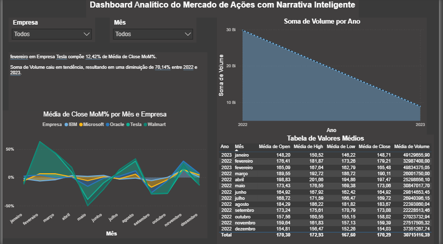

# Stock Market Dashboard — Dashboard do Mercado de Ações

Dashboard interativo desenvolvido no **Power BI** para análise de dados e acompanhamento do desempenho do mercado de ações, permitindo visualizar tendências, comparar empresas e acompanhar indicadores financeiros ao longo do tempo.

## Sobre o Projeto

Este projeto tem como objetivo analisar o comportamento do mercado de ações por meio de visualizações interativas e indicadores financeiros. O dashboard permite acompanhar a evolução dos dados por período, analisar os preços de abertura, máxima, mínima e fechamento das ações, além de visualizar o volume negociado.

A ferramenta também permite filtrar as informações por empresa e mês, facilitando a comparação de resultados e a identificação de tendências que podem apoiar análises e tomadas de decisão.

## Confira abaixo como ficou a tela principal do projeto:

## Tecnologias Utilizadas

- **Power BI:** desenvolvimento do dashboard e criação das visualizações interativas.
- **Modelagem de dados:** organização dos dados para análise dos indicadores financeiros.
- **Visualização de dados:** gráficos de área, tabelas e filtros interativos.
- **Indicadores analisados:** preços de abertura (*Open*), máxima (*High*), mínima (*Low*), fechamento (*Close*) e volume negociado (*Volume*).
- **Análise temporal:** acompanhamento dos dados por ano, trimestre, mês e dia.

## Como Visualizar

Para visualizar o projeto, é necessário ter o **Power BI Desktop** instalado.

1. Baixe ou clone este repositório.
2. Abra o arquivo `Projeto dashboard - Mercado de Ações.pbix` no Power BI Desktop.
3. Explore os gráficos, as tabelas e os filtros disponíveis para analisar os dados do mercado de ações.

O arquivo `.pbix` contém o dashboard desenvolvido e permite explorar suas visualizações interativas.
